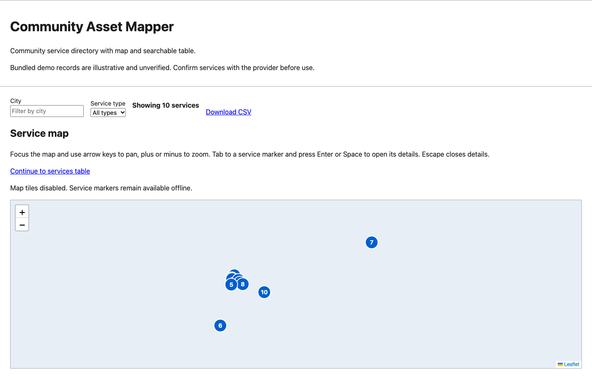
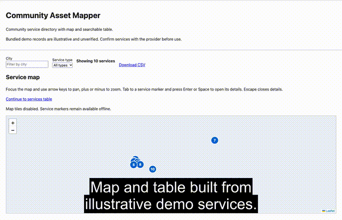
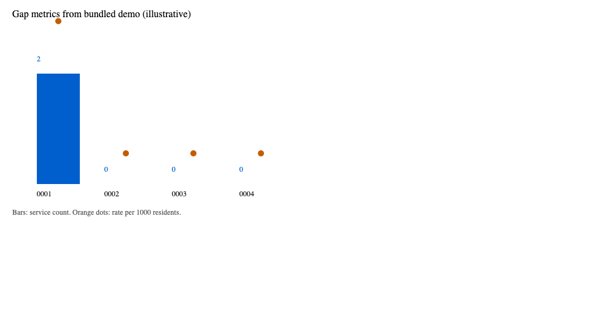
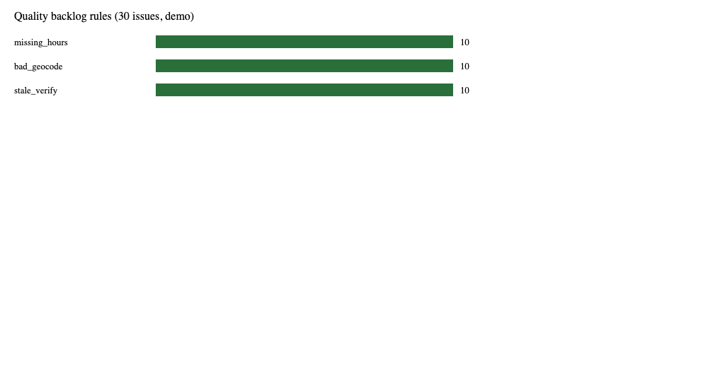
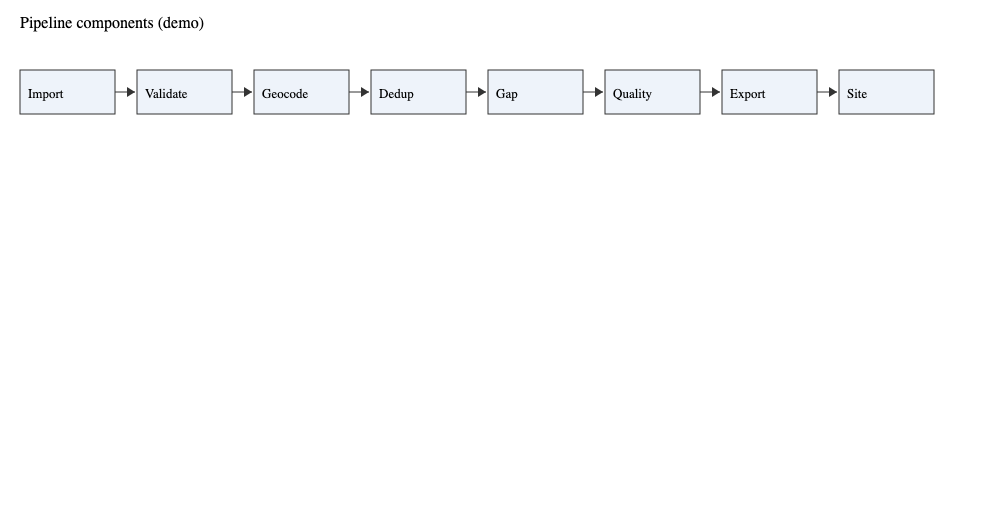
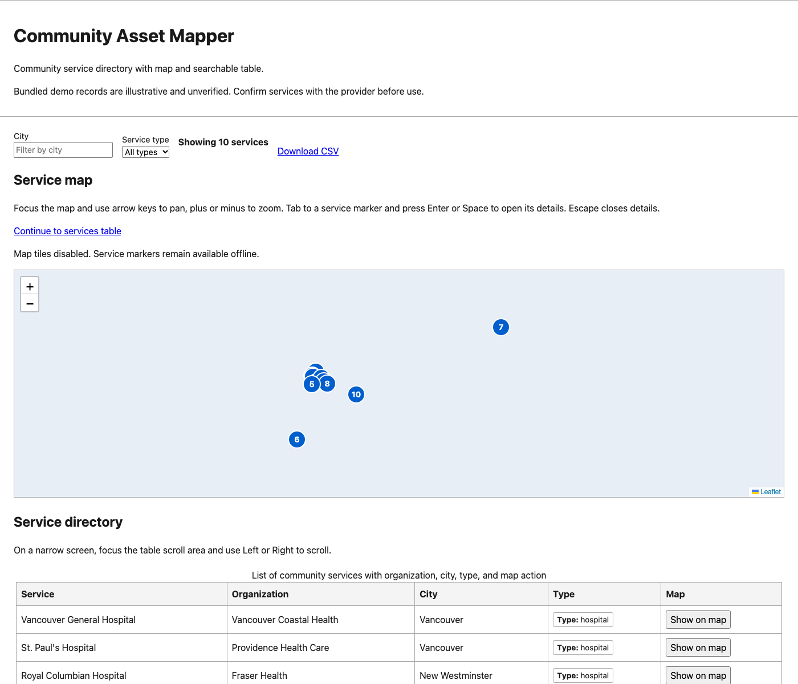
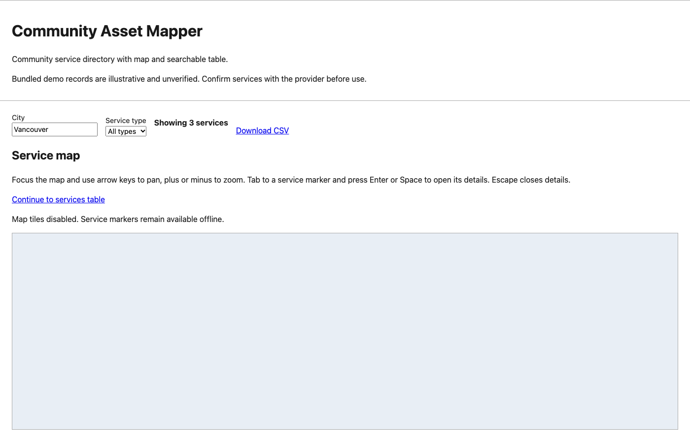
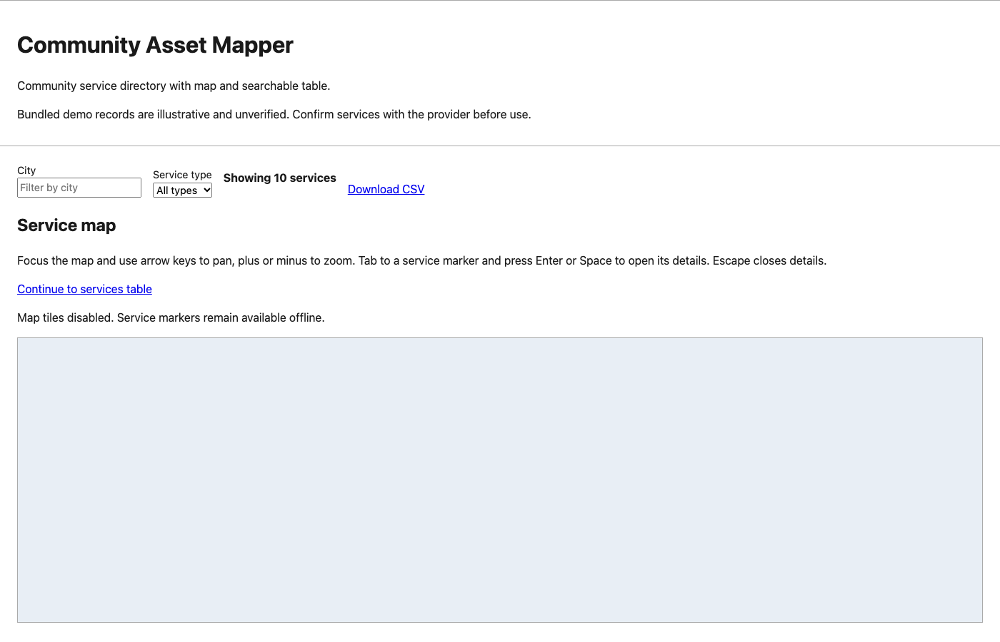
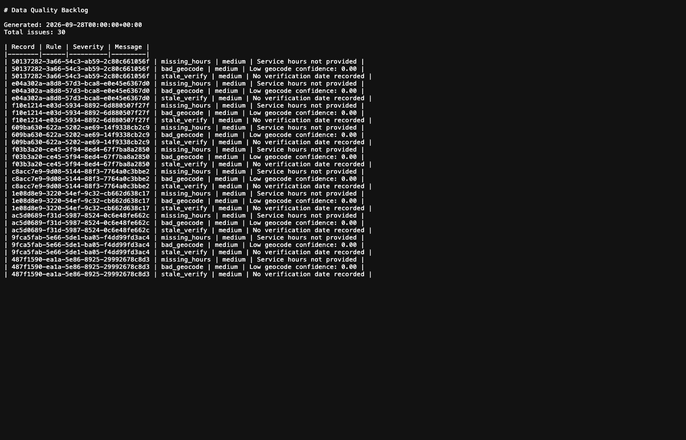

# Community Asset Mapper

**Résumé en français :** outil Python de démonstration pour préparer un inventaire
de services communautaires, vérifier certains champs HSDS et produire une carte
avec un tableau consultable. La démonstration fonctionne hors ligne. Les données
sont illustratives et non vérifiées; elles ne constituent pas un annuaire actuel.

Community Asset Mapper, a ParalleX Labs Inc. demonstration, imports hospital-style
service spreadsheets, checks selected fields against the Open Referral standard,
flags likely duplicates and builds a map and filterable table that can work offline.
Its bundled data are illustrative and unverified. For community service
organizations, information and referral lines, and municipal staff who keep
inventories of local services.



**[Try it live](https://parallexlabs.github.io/community-asset-mapper/)** (static demo in `docs/`; see [docs/PAGES_TODO.md](docs/PAGES_TODO.md)).

[](https://parallexlabs.github.io/community-asset-mapper/media/demo.mp4)

<video controls poster="docs/media/demo-poster.png" width="700">
  <source src="https://parallexlabs.github.io/community-asset-mapper/media/demo.mp4" type="video/mp4">
  <track kind="captions" src="docs/media/demo.en.vtt" srclang="en" label="English" default>
</video>

| Gap metrics (demo) | Quality rules (demo) |
| --- | --- |
|  |  |



| Map and table | Filtered view | Map popup |
| --- | --- | --- |
|  |  |  |



### How it works

1. Import a service spreadsheet (CSV or Excel); hospital-style columns become records, other columns are counted only.
2. Check records against the bundled HSDS 3.0.1 schema subset, geocode with offline fixtures, and review duplicate groups.
3. Count services by area with crude rates where population rows exist, write quality issues, and export HSDS, GeoJSON and CSV.
4. Build a static site with map, filterable table and CSV download (`--no-tiles` keeps the demo offline).

### Architecture


- CLI commands orchestrate ingest, validation, geocoding, deduplication, gap metrics, quality checks and exports.
- Bundled JSON schemas, fixtures and Leaflet assets ship inside the wheel for offline replay.
- `cam build-site` renders `docs/index.html` (or `dist/index.html` locally) from working state.

### Design choices

- Validation covers selected resource fields only, not full HSDS publication conformance.
- Gap metrics use point-in-polygon counts and crude rates, not travel times or catchments.
- The table and CSV link work without JavaScript; filtering and map controls require it.
- `--no-tiles` disables external basemap requests while keeping markers for offline demos.

### Why it matters

Service lists can be checked on selected fields, cleaned and mapped, even offline; the demo needs no sign-in or telemetry.

Showcase screenshots and the demo video are regenerated with `python scripts/make_showcase_media.py` after `cam run-demo` and `cam build-site -o dist --no-tiles`.

## Open by design

The original code uses [Apache-2.0](https://www.apache.org/licenses/LICENSE-2.0).
Directory exports use CSV, GeoJSON and JSON files that can be inspected without
an account. Bundled fixtures support an offline demonstration; generated output
stays local until its owner chooses to publish it. No sign-in, telemetry, hosted
API or external geocoder is required for the demo.

The project references [Open Referral HSDS 3.0](https://docs.openreferral.org/en/latest/hsds/overview.html)
and bundles selected 3.0.1 resource schemas under the publisher's
[CC-BY-SA 4.0 licence](https://docs.openreferral.org/en/latest/about/license.html).
Data and library licences are separate: see [DATA.md](DATA.md) and [NOTICE](NOTICE).

## Install and rebuild

Python 3.11 or newer is declared in `pyproject.toml`; the local release replay
uses Python 3.12. The pinned development dependencies include the build tools.
First acquire wheels from PyPI on a network-enabled machine:

```sh
python3.12 -m venv .venv
.venv/bin/python -m pip download --only-binary=:all: -r requirements-dev.txt -d .cam/wheels
```

Then install from that wheelhouse without package-index access:

```sh
.venv/bin/python -m pip install --no-index --find-links .cam/wheels -r requirements-dev.txt
.venv/bin/python -m pip install --no-index --no-build-isolation --no-deps -e .
export PATH="$PWD/.venv/bin:$PATH"
export CAM_OFFLINE=1
export PYTHONPATH="$PWD/scripts/offline"
cam run-demo
cam build-site -o dist --no-tiles
```

Open `dist/index.html` in a browser. `--no-tiles` disables external basemap
requests while keeping the marker map available. The table and CSV link are
present without JavaScript; filtering, map controls and map actions require it.
Generated `.cam/`, `dist/`, environments and checker output are excluded from Git.

Build an installable wheel with `python -m build --wheel --no-isolation`.
The wheel contains the schemas, demonstration data, templates, local Leaflet
assets and licence notices. A wheelhouse is specific to its Python version,
platform and architecture; acquire suitable wheels for another platform.
See [pip's download documentation](https://pip.pypa.io/en/stable/cli/pip_download/).

## Commands

| Command | Behaviour |
| --- | --- |
| `cam ingest bc_hospitals FILE` | Map hospital-style CSV columns into working records |
| `cam ingest csv FILE` / `cam ingest excel FILE` | Read tabular inputs; hospital-style columns create records, other columns are counted only |
| `cam validate` | Check projected resource objects against the bundled schema subset |
| `cam geocode --provider fixture` | Use the synthetic lookup fixtures |
| `cam geocode --provider bc` | Optional live geocoder; excluded from the demo and checks |
| `cam dedup` / `cam dedup --apply` | Propose duplicate groups or apply recommended merges with an audit log |
| `cam gap --geography da` / `csd` | Count contained points and calculate crude rates where a population row exists |
| `cam quality` | Write quality issues as JSON and Markdown |
| `cam export hsds` / `geojson` / `csv` | Export projected directory records |
| `cam run-demo` | Run bundled inputs, write deterministic demo outputs and save CLI working state |
| `cam build-site -o dist --no-tiles` | Build a map, synchronized filterable table and CSV download from working state |
| `cam --version` | Print the package version |

## Limits

- Hospital addresses and coordinates are illustrative and unverified. Hours and
  wheelchair-accessibility assertions are empty. The geometry and population
  fixtures are synthetic. They cannot support a current directory or a planning
  decision. All sources and interpretation limits are in [DATA.md](DATA.md).
- Fixture confidence and timestamps are demonstration constants, not accuracy
  measurements or live retrieval dates. Stable demo identifiers are scoped to
  the fixture rows. Ordinary ingestion uses fresh identifiers and retrieval times.
- Validation covers selected resource fields. UUID format checks, cross-resource
  relationships and complete HSDS publication conformance are not certified.
  The JSON manifest is a project convenience format. Consult the publisher's
  [serialization rules](https://docs.openreferral.org/en/latest/hsds/serialization.html)
  before integrating with an HSDS consumer.
- Gap output uses point-in-polygon counts and crude rates. It implements neither
  population allocation nor catchments, travel times, or a validated accessibility
  model. Missing population rows produce zero rates with `unknown` provenance;
  those zeroes do not establish service adequacy or absence.
- State and exports can retain supplied directory and raw spreadsheet fields.
  Quality checks identify selected column names; they do not anonymize input.
  Use trusted local paths, review output before sharing, and read [SECURITY.md](SECURITY.md).
- Indigenous community data requires community-specific authority and protocols
  before ingestion. See [FNIGC's OCAP guidance](https://fnigc.ca/ocap-training/)
  and [CARE principles](https://www.gida-global.org/care).
- The optional basemap follows [OpenStreetMap attribution](https://www.openstreetmap.org/copyright)
  and [tile usage requirements](https://operations.osmfoundation.org/policies/tiles/).
  Live geocoder use is subject to [publisher API terms](https://www2.gov.bc.ca/gov/content/data/policy-standards/data-policies/open-data/api-terms-of-use-for-ogl-information).
- Local automated and keyboard checks have a bounded scope documented in
  [docs/accessibility.md](docs/accessibility.md). No accessibility conformance
  claim, production security review or legal compliance claim is made.

## Development checks

With the environment installed and the offline variables above set:

```sh
ruff check
mypy src
pyright
pytest --cov
```

For optional browser checks, acquire the pinned npm development dependencies with
`npm ci --ignore-scripts`. Set `CAM_BROWSER_PATH` to a locally installed Chromium
browser and run `npm run check:accessibility -- dist/index.html`.
The checker serves generated files on a loopback HTTP port and blocks external page requests; it does not install a browser or ship
its packages in the generated site. See [Playwright browser configuration](https://playwright.dev/docs/api/class-browsertype)
and [axe's Playwright integration](https://www.npmjs.com/package/@axe-core/playwright).

[CONTRIBUTING.md](CONTRIBUTING.md) describes offline checks. Local results and
replay scope are recorded in `docs/release-checks.md`; hosted CI has not been run.
